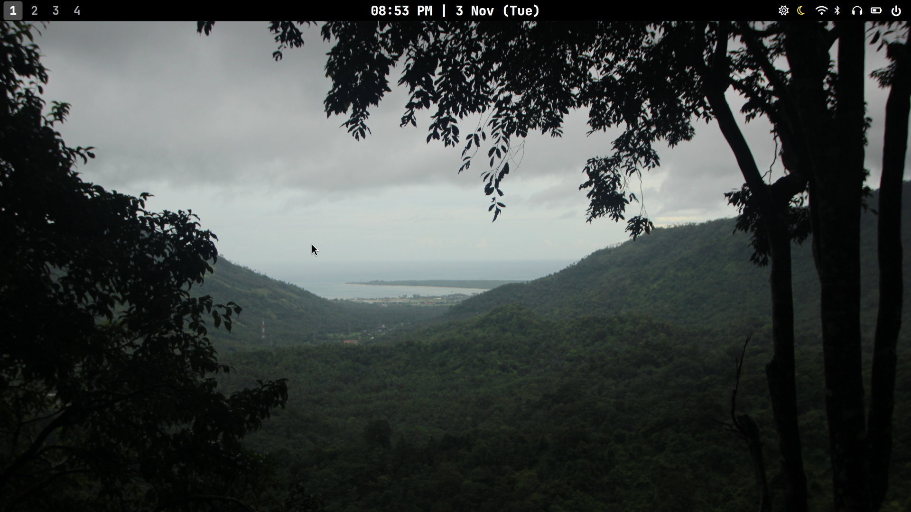
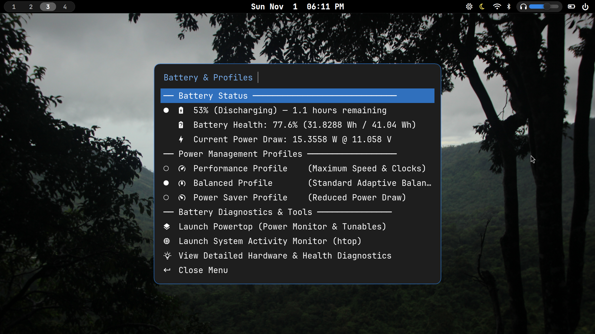

# dotfiles

Personal Wayland desktop configuration files, scripts, and themes.



## Overview

A clean, responsive, pure Wayland desktop setup based on the **Niri** scrollable-tiling window manager, **Waybar**, **Fuzzel**, **Ly** display manager, and **Veila** screen locker.

### Sample Menus

<p align="center">
  
</p>

---


## Contents

- **[niri](.config/niri/)**: Configuration for the [Niri](https://github.com/YaLTeR/niri) scrollable-tiling Wayland compositor (`config.kdl`) and helper scripts (`brightness.sh`, `volume.sh`).
- **[waybar](.config/waybar/)**: Highly customized status bar (`config.jsonc`, `style.css`) with integrated Fuzzel menus and monitoring scripts:
  - Workspaces indicator & listener (`ws_listener.sh`, `click_ws.sh`, `get_ws.sh`)
  - Battery & Power profile manager (`fuzzel_battery.sh`)
  - Power / Session manager (`fuzzel_power.sh`)
  - WiFi & Bluetooth toggles (`fuzzel_wifi.sh`, `fuzzel_bluetooth.sh`)
  - Night light slider & daemon (`nightlight.py`, `nightlight_slider.py`)
  - Wallpaper manager (`set_wallpaper.sh`)
- **[fuzzel](.config/fuzzel/)**: Configuration for the [Fuzzel](https://codeberg.org/dnkl/fuzzel) Wayland application launcher (`fuzzel.ini`).
- **[ly](.config/ly/)**: Configuration for [Ly](https://github.com/fairyglade/ly) TUI display manager (`config.ini`, `config.lua`) configured for pure Wayland sessions.
- **[veila](.config/veila/)**: Configuration for the [Veila](https://github.com/naurissteins/Veila) Wayland screen locker (`config.toml`).
- **[celluloid](.config/celluloid/) / [mpv](.config/mpv/)**:
  - `hold-to-speedup.lua`: YouTube-style playback speed script that pauses on spacebar tap and ramps to 2x speed while holding the spacebar.
- **[.bashrc](.bashrc)**: Interactive bash shell configuration and environment paths.

---

## Repository Structure

```text
dotfiles/
├── .bashrc
├── .config/
│   ├── celluloid/
│   │   └── scripts/
│   │       └── hold-to-speedup.lua
│   ├── fuzzel/
│   │   └── fuzzel.ini
│   ├── ly/
│   │   ├── config.ini
│   │   └── config.lua
│   ├── mpv/
│   │   └── scripts/
│   │       └── hold-to-speedup.lua
│   ├── niri/
│   │   ├── config.kdl
│   │   └── scripts/
│   │       ├── brightness.sh
│   │       └── volume.sh
│   ├── veila/
│   │   └── config.toml
│   └── waybar/
│       ├── config.jsonc
│       ├── style.css
│       └── scripts/
├── screenshots/
│   ├── desktop.png
│   └── fuzzel_menu.png
├── .gitignore
├── LICENSE
└── README.md
```

---

## License

[MIT](LICENSE)
